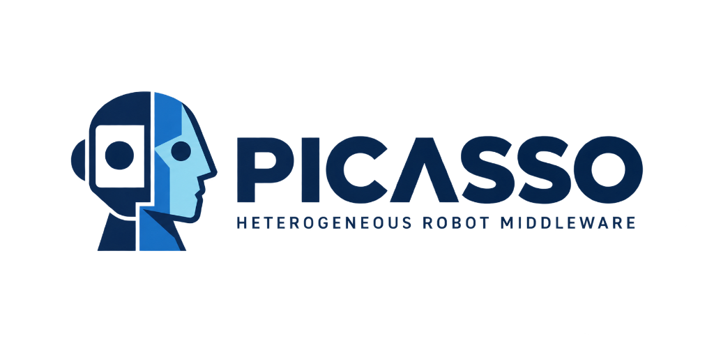
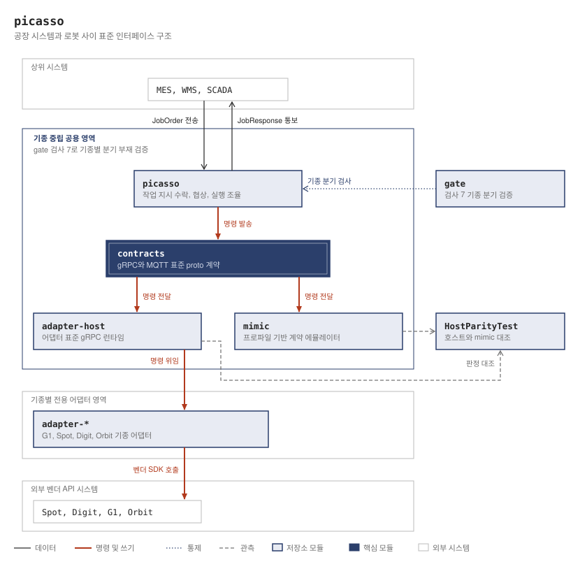

<p align="center">
  
</p>

# picasso — 로봇의 차이와 운영 변경을 다루는 미들웨어

[](https://github.com/LivingLikeKrillin/picasso/actions/workflows/ci.yml)
[](LICENSE)

공장에서 로봇에 작업을 지시할 때는 단순한 명령 전달만으로 충분하지 않습니다. 기종마다 수행 가능한 동작이 다르고, 응답을 수신했다고 해서 실제 작업이 끝났음을 보장할 수도 없습니다. 로봇이나 인터페이스를 변경할 때는 기존 임무에 미칠 영향도 사전에 파악해야 합니다.

**picasso는 이러한 차이를 표준 계약, 능력 프로파일, 실행 근거로 다루는 로봇 미들웨어 PoC입니다.** 기종별 코드는 어댑터로 격리하고 공통 실행 구조를 공유합니다. 실물 장비가 없어도 `mimic`으로 계약과 장애 상황을 시험하고, 프로파일·바인딩 변경의 영향을 레지스트리에서 확인할 수 있습니다.

이 저장소는 계약과 실행 코어를 제공합니다. MES 주문 접수와 운영 화면은 [picasso-ops](https://github.com/LivingLikeKrillin/picasso-ops), LLM을 활용한 근거 설명은 [picasso-narrator](https://github.com/LivingLikeKrillin/picasso-narrator)가 담당합니다. **실물 로봇 연결은 아직 검증하지 않았습니다.**

## 대표 시나리오

부품 시퀀싱 임무를 예로 들면 다음 질문을 차례대로 해결합니다.

1. 이 로봇이 필요한 이동·파지·배치 능력을 갖추었는가? 프로파일과 임무 요구사항을 대조합니다. 확인하지 못한 능력은 `UNKNOWN`으로 남깁니다.
2. 작업을 수락한 뒤 무엇을 수행했고 어떤 근거를 받았는가? 실행 상태와 근거를 결합해 결과를 도출합니다.
3. 자재가 없거나 통신이 끊기면 어떻게 되는가? 실패, 불확실, 작업자의 판단이 필요한 상태를 구분합니다.
4. 어댑터나 프로파일을 변경하면 어디에 영향이 미치는가? 의존 원장과 변경 계획으로 확인합니다.

[공장 시나리오](docs/scenarios.md)에 이 흐름의 검증 사례가 있으며, 위 네 질문 가운데 1~3번은 `SequencingRackTest`가, 2번의 효과 대조는 `EffectMismatchTest`가, 4번(변경 영향)은 `ShrinkRefusalTest`(소비자나 진행 중 태스크가 남아 있으면 능력 제거 계획의 제거 단계가 거부됨)가 검증합니다. 제조 현장의 실제 성능을 측정한 결과는 아닙니다.

## 무엇을 검증하는가

| 설계 문제 | 구현 | 확인할 근거 |
|---|---|---|
| 기종 추가 시 공통 코드로 차이가 새어 들어감 | 표준 계약·프로파일과 기종별 어댑터의 분리 | [접합부](docs/seams.md), 게이트 검사 7, `HostParityTest` |
| 설정 변경이 기존 소비자를 깨뜨림 | 개정판·바인딩·의존 원장·변경 계획 | [변경 관리](registry/README.md), [계약](docs/contract.md) |
| 수락·응답·실제 완료를 혼동함 | 실행 상태와 태스크 상태의 분리, 근거 등급과 효과 대조 | [실행 모델](picasso/README.md), `EffectMismatchTest`, `SequencingRackTest`(로봇은 끝났다는데 설비가 말이 없으면 UNVERIFIED, 셀 장치가 확인하면 E2 로 물리 완료) |
| 실물 준비 전 장애를 시험하기 어려움 | 시드와 가상 클록을 쓰는 `mimic`, 결함 주입 | [에뮬레이터](mimic/README.md), [검증 범위](docs/verification.md) |

<picture>
  <source media="(prefers-color-scheme: dark)" srcset="docs/diagrams/seam.dark.svg">
  
</picture>

## 세 저장소의 역할

| 저장소 | 책임 | 연결 방식 |
|---|---|---|
| **picasso** | 계약·능력 협상·공통 실행·어댑터·레지스트리 | 이 저장소 |
| [picasso-ops](https://github.com/LivingLikeKrillin/picasso-ops) | 미션 정의와 상위 주문 매핑, 영속 접수, 공유 자원 조정, 운영 UI | 고정 커밋의 picasso를 라이브러리로 사용 |
| [picasso-narrator](https://github.com/LivingLikeKrillin/picasso-narrator) | 사건과 운영 근거의 설명, 계산된 후보에 대한 권고 | 내보낸 파일과 별도 진단 계약 사용 |

picasso의 빌드와 코드는 두 소비자 저장소를 참조하지 않습니다. HTTP 주문 API는 Ops에 있으며, Core 자체가 MES·WMS 연결 제품을 제공하는 것은 아닙니다. 소비자별 기능과 검증 범위는 각 저장소의 README를 따릅니다.

## 시스템 모듈 구성

<details>
<summary>모듈과 책임 보기</summary>

```
contracts/                proto. 스킬·태스크·이벤트·결함. 프로젝트 내 의존 0
profile/
  schema/                 능력 프로파일 JSON Schema (+ 조사·거리·출처 스키마)
  profiles/               기종 프로파일 문서 (실물 셋 + 시험용 가상 기종)
  fixtures/ requirements/ 게이트·시험 전용 픽스처와 소비자 요구 집합
  vendors/                벤더 1차 자료 조사 — 무엇을 선언하고 무엇을 안 하는가
  distance/               계약 어휘와 벤더 표면의 거리 측정 (survey_scope 필수)
  provenance/             프로파일의 각 값이 어느 원문에서 왔는가
profile-model/            프로파일 문서의 읽기 전용 모델 — gate·mimic 공유
capability/               능력의 투영과 판정 — 프로파일 → Capability, 요구 집합 대 Capability 협상.
                          mimic·어댑터 호스트 공유. 전송을 모른다
uplink/                   발신자의 위쪽 결선 — 브로커 발행과 레지스트리 적재. mimic·어댑터 호스트 공유
gate/                     검증 규칙의 단일 구현. CI 와 registry 가 같은 코드를 호출
mimic/                    프로파일 주도 에뮬레이터 — "어댑터 + 로봇" 한 쌍을 대신
client/                   계약을 두드려 완료 기준을 증명하는 얇은 소비자
harness/                  계약 스위트의 주인. mimic 을 띄우고 client 로 돈다
registry/                 개정판·어댑터 수명주기, 바인딩, 의존 원장, 변경 계획, 카탈로그
picasso/                  미들웨어의 가운데 — 정준 모델(실행 상태 두 축·근거 등급·논리적 능력·취소 응답)과
                          공통 실행 구조. 접수 → 조합 → 실행 → 근거 결합 → 결과 통보. 기종을 모른다 (ADR 38)
adapter-core/             어댑터들이 공유하는 계약 쪽 어휘와 RobotAdapter. 기종을 모른다
adapter-host/             어댑터 하나를 계약의 gRPC 서비스 뒤에 세우는 서버. 기종을 모른다(ADR 39)
adapter-unitree-g1/       실물 어댑터 — 기종을 아는 유일한 자리 (기종마다 모듈 하나)
adapter-boston-dynamics-spot/
adapter-agility-digit/
adapter-boston-dynamics-orbit/
                          기체가 아니라 **플릿**에 붙는 어댑터 + 배치 런처. 발견이 여기서 실증된다(ADR 37)
tools/buf                 buf 를 Docker 로 실행하는 래퍼
tools/vendor-manifest/    벤더 원문에서 심볼 이름만 뽑아 남쪽 포트의 인용을 대조하는 도구
docs/adr/                 결정 기록
docs/environment-preconditions.md
                          이 일감을 시키려면 현장에 무엇이 있어야 하는가 — 설계 입력
docs/vendors/             로봇이 아닌 벤더 표면의 측정 노트 (플릿 관리 API)
```

</details>

명령·질의는 gRPC, 상태·이벤트·연결 스트리밍은 MQTT를 사용합니다. `capability`는 능력 판정을, `adapter-host`는 계약 서버를, `registry`는 개정판과 운영 변경을 담당합니다. 진단 표면 열 개(/diag/*)는 [registry](registry/README.md)에, 모듈 의존성은 [아키텍처](docs/architecture.md)에 정리되어 있습니다.

## 빌드 및 테스트 실행

JDK 21과 Docker가 필요합니다. Docker는 buf 래퍼와 Testcontainers의 PostgreSQL·Mosquitto 실행에 사용합니다.

```bash
./gradlew build -Dpicasso.negative.strict=true -Dpicasso.buf="$PWD/tools/buf"
```

위 명령은 리눅스·macOS와 CI용입니다. Windows에서는 Git Bash와 JDK 21을 쓰되 `picasso.buf` 값의 형식이 다릅니다. Git Bash의 `$PWD` 경로(`/c/...`)는 Java가 실행하지 못하므로, `bash.exe` 경로와 아무 값을 `|`로 이어 지정합니다.

```bash
./gradlew build -Dpicasso.negative.strict=true "-Dpicasso.buf=C:/Program Files/Git/bin/bash.exe|tools/buf"
```

위 명령은 전체 빌드·검증 명령이며, 실행 시간과 Docker 준비가 필요합니다. 운영 화면으로 흐름을 확인하려면 [picasso-ops 실행 안내](https://github.com/LivingLikeKrillin/picasso-ops#띄우기)를 따르세요.

문서와 구현의 수치·링크·완료 기준만 대조할 때는 다음과 같이 실행합니다.

```bash
./gradlew :gate:test --tests '*DocumentClaimsTest*' --tests '*CompletionCriterionTest*'
```

CLI 옵션과 프로파일 입력은 [mimic](mimic/README.md), [client](client/README.md), [harness](harness/README.md)를 참고하세요.

## 검증 현황 및 한계 관리

계약 개정판은 **0.9.0**입니다. 게이트 검사 열이 있고 CI와 `registry`가 같은 검증 구현을 사용합니다. README의 모듈 목록과 주요 수치는 `DocumentClaimsTest`가, 문서 본문과 대조 스탬프는 `CompletionCriterionTest`가 확인합니다. 자동 대조가 모든 기술 주장의 참을 보장하는 것은 아니므로 [검증 범위](docs/verification.md)와 한계 레지스터를 함께 읽어야 합니다.

실물 어댑터가 넷 있다: 기체용 셋과 플릿용 하나입니다. **어댑터 넷 중 어느 것도 실물에 붙여 보지 못했다**는 한계(C-3)가 있습니다. 실물 넷이 계약에 얼마나 닿나 조사한 결과는 [어휘 거리 측정](profile/distance/)에 있습니다. 벤더 표면 조사와 대역 시험은 실제 SDK 연결·현장 성능·산업 안전 검증을 대신하지 않습니다.

한계 레지스터에 등록된 미결 항목은 **94개**입니다. 내부 42개 · 소비자 대기 24개 · 외부 28개이며 의도적 제외 13개는 이 합계에 넣지 않습니다. [미결 한계 항목 94개](docs/limits.md)의 해결 조건을 추적합니다. 경로 계획·교통 제어·안전 인증의 제공 여부도 이 범위 안에서 해석해야 합니다.

## 문서 체계 가이드

| 문서 분류 | 대상 문서 및 링크 | 설명 |
|---|---|---|
| **검증 신뢰도** | [`docs/verification.md`](docs/verification.md) | 구간별 실제 하드웨어 기체, 실 네트워크, 모의 대역(Mock) 적용 범위 및 검증 수준 정의 |
| **아키텍처** | [`docs/architecture.md`](docs/architecture.md) | 4단계 어휘 모델(ADR 36), 데이터 흐름, 상태 전이 모델 및 의존성 규칙 |
| **오케스트레이션과 자원 소유** | [`docs/orchestration.md`](docs/orchestration.md) | 배정·실행 보증·경로 세 계층의 구분, 자원별 소유자와 게이트 레지스터, 배선도 |
| **인터페이스 계약** | [`docs/contract.md`](docs/contract.md) | 계약 진입 게이트 규칙, 지원 범위 한계, 계약 보장 항목 및 1:1 테스트 매핑 |
| **인터페이스 접합부** | [`docs/seams.md`](docs/seams.md) | 9대 접합부(Seam) 명세, 대상 인터페이스 및 실제 하드웨어 전환 가이드 |
| **어댑터 개발** | [`tools/adapter-template/`](tools/adapter-template/README.md) | 신규 기종 어댑터 구현을 위한 7개 필수 구성 요소 및 템플릿 가이드 |
| **어휘 거리 측정** | [`docs/vocabulary-distance.md`](docs/vocabulary-distance.md) | 벤더 API 명세와 계약 스킬 간의 어휘 거리 측정 절차 및 유의점 |
| **상위 표준 연계** | [`docs/isa95.md`](docs/isa95.md) | ISA-95 표준 데이터 모델 매핑 및 미들웨어 계층의 근거 등급 정의 |
| **현장 시운전** | [`docs/commissioning.md`](docs/commissioning.md) | 마스터 데이터 설정, 10단계 시운전 절차 및 관리 API 표면 명세 |
| **모듈별 상세 명세** | 모듈별 `README.md` 참조 | 각 모듈의 단일 책임 원칙, 경계 조건, 테스트 항목 명세 ([`contracts`](contracts/README.md) → [`picasso`](picasso/README.md) → [`adapter-host`](adapter-host/README.md)) |
| **설계 정본 스펙** | [공식 설계 문서](docs/superpowers/specs/2026-09-05-picasso-design.md) | 목적, 비목표(Non-goals), 세부 아키텍처, 계약, 프로파일, 변경 관리 종합 사양 |
| **한계 및 이력** | [설계 문서 §15 알려진 한계](docs/superpowers/specs/2026-09-05-picasso-design.md#15) | 설계 변경 이력 및 누적 정정 기록 |
| **운영 시나리오** | [`docs/scenarios.md`](docs/scenarios.md) | 공장 3대 시나리오(용기 공급 AMR, 부품 시퀀싱, 설비 점검) 및 완료 증명 체계 |
| **미들웨어 코어** | [`docs/superpowers/specs/2026-09-09-middleware-core-design.md`](docs/superpowers/specs/2026-09-09-middleware-core-design.md) | 정준 실행 모델, 논리적 케이퍼빌리티 정의, 근거 등급 결합 및 장애 전이 모델 |
| **설계 결정 기록** | [ADR 색인](docs/adr/README.md) | 주요 아키텍처 결정 레코드 (ADR 9, 10, 22, 23, 29~53) |
| **벤더 인터페이스** | [`profile/vendors/`](profile/vendors) · [`docs/vendors/orbit.md`](docs/vendors/orbit.md) | 벤더 API 표면 분석 및 플릿 관리 인터페이스 측정 노트 |
| **현장 전제조건** | [`docs/environment-preconditions.md`](docs/environment-preconditions.md) | 로봇 도입 현장의 인프라(도어, 바닥, 조명 등) 엔지니어링 전제조건 |
| **벤더 매니페스트** | [`tools/vendor-manifest/README.md`](tools/vendor-manifest/README.md) | 어댑터의 사우스바운드 포트 벤더 심볼 인용 대조 검증 도구 |
| **오픈 항목 과제 레지스터** | [`docs/limits.md`](docs/limits.md) | 미결 한계 항목 94개(내부·소비자 대기·외부) 및 해결 조건 관리 레지스터 |

## 라이선스

[Apache License 2.0](LICENSE). 벤더 독점 SDK는 포함하지 않습니다. 어댑터의 벤더 API 인용은 심볼명과 해시 매니페스트로 관리합니다.

> 마지막 대조: 2026-10-19 · sha256:dc7cd800d7db · 열림: C-3, §15.81
